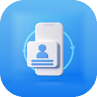

<div align="center">



# Contax 📱

**مدیریت کامل مخاطبین دستگاه، سیم‌کارت و حساب‌ها همراه با بکاپ رمزگذاری‌شده**

[](https://github.com/YOUR_GITHUB_USERNAME/Contax/releases)
[]()
[]()
[]()
[](LICENSE)

</div>

---

<div align="center">

**Contax** اپلیکیشنی بومی (Native) برای مدیریت مخاطبین است؛ طراحی‌شده با تمرکز روی کاربران فارسی‌زبان.
همه مخاطبین دستگاه، دو سیم‌کارت و حساب‌های همگام‌شده (Google / Exchange) را در یک‌جا جمع می‌کند،
بکاپ امن می‌گیرد و در صورت نیاز همه چیز را دقیقاً برمی‌گرداند.

</div>

---

## ✨ امکانات

### 👥 مدیریت مخاطبین
- نمایش مخاطبین همه منابع: **حافظه دستگاه، سیم‌کارت ۱، سیم‌کارت ۲، Google، Exchange**
- فیلتر سریع بر اساس منبع + برچسب منبع کنار هر مخاطب
- افزودن، ویرایش، حذف، علاقه‌مندی، تماس و پیامک
- فیلدهای کامل: چند شماره با لیبل (موبایل/خانه/کار)، ایمیل، سازمان، آدرس، یادداشت و عکس
- کپی / انتقال مخاطبین بین منابع (دستگاه ↔ سیم‌کارت ↔ حساب‌ها) تکی یا گروهی
- انتخاب چندتایی برای حذف، انتقال، کپی و بکاپ گروهی

### 💾 بکاپ و بازیابی
- فرمت‌های استاندارد **VCF / CSV / JSON**
- ذخیره در حافظه داخلی برنامه یا مکان دلخواه (SD کارت، Google Drive از طریق انتخابگر سیستم)
- رمزگذاری با **AES-256-GCM** — کلید دستگاه (Keystore) یا گذرواژه (PBKDF2)
- بازیابی کامل یا انتخابی، با سیاست رد کردن شماره‌های تکراری
- **مقایسه بکاپ با مخاطبین فعلی** (فقط در بکاپ / فقط در دستگاه / مشترک)
- بکاپ خودکار زمان‌بندی‌شده (روزانه / هفتگی + انتخاب ساعت) با اعلان نتیجه

### 🧰 ابزارهای هوشمند
- تشخیص و **ادغام مخاطبین تکراری** (شماره یکسان / نام یکسان) تکی یا همه‌باهم
- آمار مخاطبین بر اساس منبع
- درون‌ریزی فایل‌های VCF / CSV / JSON

### 🎨 تجربه کاربری
- طراحی مدرن **Material 3** با تم روشن / تاریک / سیستم
- **فارسی کامل RTL + انگلیسی** (تغییر زبان از داخل برنامه)
- اعداد فارسی و **تاریخ شمسی** در همه‌جا

### 🔐 امنیت
- قفل برنامه با **PIN (۴ تا ۶ رقم)** یا **اثر انگشت**
- رمزگذاری فایل بکاپ + مجوزها با توضیح شفاف؛ هیچ داده‌ای از دستگاه شما خارج نمی‌شود
- **آپدیت‌چکر داخلی**: با انتشار نسخه جدید، پاپ‌آپی با لیست تغییرات نمایش داده می‌شود و می‌توانید همان‌جا آپدیت کنید

---

## 🖼 تصاویر برنامه

<p align="center">
  
  
  
  
</p>

---

## ⬇️ دانلود

آخرین نسخه از بخش [Releases](https://github.com/YOUR_GITHUB_USERNAME/Contax/releases) گیت‌هاب قابل دریافت است.

---


---

## 🧱 تکنولوژی‌ها

<div align="center">

**Kotlin** • **Jetpack Compose** • **Material 3** • **Room** • **DataStore** • **WorkManager** • **BiometricPrompt** • **ContactsContract Provider**

</div>

---

## 🗂 ساختار پروژه

```
app/src/main/java/com/contax/app/
├── ContaxApp.kt / MainActivity.kt / MainViewModel.kt
├── data/
│   ├── model/           مدل‌های دامنه
│   ├── contacts/        مخزن مخاطبین + خواندن سیم‌کارت
│   ├── backup/          کدک VCF/CSV/JSON، رمزنگاری، مخزن بکاپ
│   ├── update/          آپدیت‌چکر داخلی (GitHub Releases)
│   ├── db/              Room (تاریخچه بکاپ)
│   ├── prefs/           DataStore (تنظیمات)
│   └── work/            WorkManager (بکاپ خودکار)
├── ui/
│   ├── theme/           تم Material 3
│   ├── common/          کامپوننت‌های مشترک
│   ├── navigation/      ناوبری و تب‌ها
│   ├── contacts/        لیست، جزئیات، فرم مخاطب
│   ├── backup/          بکاپ و بازیابی
│   ├── tools/           آمار، تکراری‌ها، درون‌ریزی
│   ├── settings/        تنظیمات + درباره برنامه
│   └── lock/            قفل برنامه
└── util/                اعداد فارسی، تاریخ شمسی، نرمال‌سازی شماره
```
---

## 📄 لایسنس

این پروژه تحت لایسنس [MIT](LICENSE) منتشر شده است.

<div align="center">

</div>
